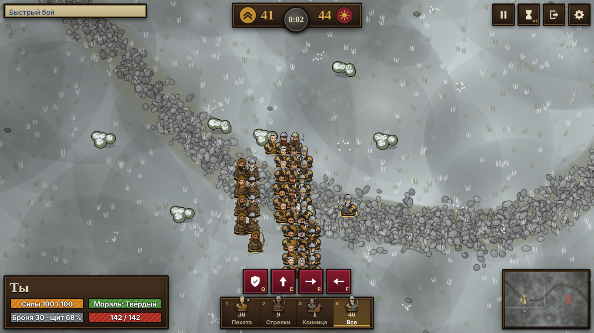
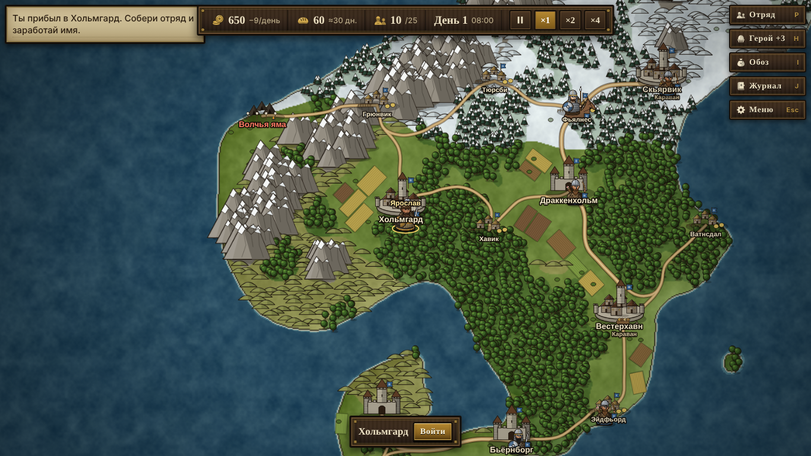

# Железный Стяг

Браузерная инди-игра про наёмный отряд. Бои армий в реальном времени, как в Mount & Blade: Bannerlord, и рисованная графика в духе Battle Brothers. Вся графика и звук создаются кодом, внешних файлов нет.

> **Игра только для компьютера (десктопный браузер).** Нужны клавиатура и мышь. На телефонах и планшетах она не рассчитана и не поддерживается.

**Играть:** `https://akglebak16.github.io/iron-standard/`

Что нового — в [CHANGELOG.md](CHANGELOG.md).



## Что есть
- Карта мира: стилизованная Европа 5200×3400 с горами, реками (переходить только по мостам), морями, степью, снегом и пустыней; города, замки, деревни, логова разбойников, семь фракций (Нордмарк, Аурелийская империя, Кеширское ханство, Королевство Галлия, Эмират Хайрат, Мядельский доминион, Варшавско-Познаньский пакт), лорды и караваны, смена дня и ночи. Старые сохранения идут на старой карте (2600×1700, три фракции).
- Бой в реальном времени до 150 фигур на сторону (если людей больше, их заменяют более крепкие бойцы, потери считаются в людях). Ты ведёшь героя сам, остальным отдаёшь приказы. Есть мораль, стрелки, конница, копейщики против конницы, удары в спину.
- Расчленёнка: рубящий удар может снести голову (она летит и катится, из шеи бьёт фонтан) или отсечь руку, дробящий — разбить голову вдребезги. Кровь брызжет по направлению удара, растекается лужами и остаётся на поле до конца боя. Скелеты сыплют костями, мертвецы — тёмной жижей. Отключается в меню паузы.
- Лорды ведут большие армии, по 130–190 бойцов: с ними не справиться лобовой атакой без сильного отряда.
- Вассалы: у каждой фракции отряды по 50–80 бойцов (хёвдинги, трибуны, багатуры, шевалье, сипахи). Они служат лордам: то идут за своим лордом, то объезжают деревни и замки. Это средние противники между шайками разбойников и армиями лордов.
- Нашествие нежити: в случайный день между 40-м и 60-м из Чёрных курганов выходят огромные армии мертвецов (в одиночной игре 700–1000 в каждой, по 3 сразу с кургана) и разъезды. Нежити много, но поодиночке она слабая; мертвецы не бегут, поднимают павших, жгут деревни и берут замки и города, превращая их в руины. Руины можно отбить, а нашествие остановить, разрушив курганы.
- Наём и улучшение войск, уровни, жалованье и провизия, задания на досках.
- Осады: штурм замков и городов через проломы в стене, свои владения с доходом и гарнизоном. Враждебные фракции (отношения ниже −20) подсвечены на карте красным, их лорды нападают и отбивают твои владения. Гарнизоны фракций: замки 48–72, города 64–92 бойца. Свои владения дают доход (город 200, замок 100, плюс 15 за каждую деревню той же культуры поблизости), а гарнизон получает половину полевого жалованья.
- Снаряжение героя по слотам: голова, тело, руки, ноги, оружие в руках, дальнее оружие, щит, конь. Мечи, топоры, булавы, копья, двуручное и древковое оружие (пика, алебарда), луки, арбалеты и метательные копья. У оружия свой тип урона (рубящий, колющий, дробящий), и он по-разному пробивает лёгкую, среднюю и тяжёлую броню. С двуручным и с луками щит не носится. Боеприпасы бесконечные.
- Торговля как в Mount & Blade: цены зависят от запасов в городе, товары производят и потребляют разные поселения, обоз ограничен по весу, трофеи после боя.
- РПГ-герой: пять атрибутов (Сила, Стойкость, Ловкость, Интеллект, Харизма). За уровень даётся 2 очка атрибутов и 1 очко перков. У каждого атрибута четыре перка, всего 20. Все перки доступны сразу, у каждого три уровня, и каждый следующий уровень требует большего значения атрибута (обычно 3, 6 и 9, у самых сильных перков 4, 7 и 10) и стоит одно очко перков. Например, «Крепкая хватка» усиливает двуручное и древковое оружие, «Хирургия» оставляет больше павших бойцов ранеными.
- Спутники: одиннадцать уникальных героев со своей историей сидят по тавернам городов. Нанятый спутник бьётся рядом с тобой под управлением ИИ, слушается приказов, растёт в уровнях, носит вещи из обоза и даёт отряду своё умение (лекарь, следопыт, казначей, знаменосец и другие). Спутники не гибнут, а получают ранения.
- Быстрый бой, сохранение в браузере. Управление: клавиатура и мышь.



## Управление
| | Карта мира | Бой |
|---|---|---|
| Движение | клик | W A S D, Shift — бег |
| Действие | клик по лагерю или отряду — погоня | левая кнопка — удар, правая — блок |
| Отряд | P отряд, H герой, I обоз, J журнал | 1 2 3 4 выбор, Q держать, E за мной, R атака, F отход |
| Оружие | в панели героя (I) — «В руки» | X или кнопки с оружием в панели героя — ближнее и дальнее оружие |
| Время | Пробел — пауза, Z — ждать, 1 2 3 — скорость | P — пауза, T — скорость |

## Сборка
Игра собирается в один файл `index.html` из исходников в `src/`. **Сам `index.html` в репозиторий не коммитится** (он в `.gitignore`): его собирает GitHub при каждой заливке в `main` и сразу выкладывает на GitHub Pages. Так у двоих разработчиков не бывает конфликтов в огромном собранном файле.

Собрать у себя, чтобы поиграть или проверить правки:

```
node build.mjs
```

Нужен только Node.js, зависимостей нет. Открыть `index.html` можно двойным кликом.

## Тесты
`tests/smoke.cjs` открывает игру в настоящем браузере и проверяет то, что уже ломалось: плавность движения по карте, кнопки верхнего меню, приказы армии в бою, залипание клавиш, обновление окон в игре вдвоём. Тест сам собирает игру и поднимает сервер на свободном порту.

```
npm i --no-save playwright && npx playwright install chromium   # один раз
npm test
```

На GitHub эти же тесты гоняются автоматически (вкладка Actions) при каждой заливке в `main` и для каждого pull request. Если тест упал, на Pages ничего не выкладывается и старая версия игры остаётся. Чинили баг — добавь на него проверку в `tests/smoke.cjs`.

## Структура
- `src/01_core.js` — утилиты и данные войск
- `src/01b_gear.js` — каталог снаряжения, слоты, типы урона и пробития брони
- `src/01c_perks.js` — каталог перков героя, очки атрибутов и перков, сумма эффектов
- `src/02_art.js` — рисование бойцов, знамён, поля боя
- `src/03_battle.js` — симуляция и отрисовка боя
- `src/03b_gore.js` — расчленёнка: отрубленные головы и руки, брызги, лужи крови
- `src/04_audio.js` — звук
- `src/05_world.js` — карта мира, ИИ отрядов, задания
- `src/05d_trade.js` — торговля, рынки городов, надевание снаряжения, трофеи
- `src/05e_comps.js` — спутники: каталог, таверны, наём, умения, рост, участие в бою
- `src/05f_undead.js` — нашествие нежити: курганы, армии, сожжение деревень, руины, отбитие
- `src/06_ui.js`, `src/07_main.js` — интерфейс и главный цикл
- `src/06b_inventory.js` — окно обоза и экипировки, торговые вкладки
- `src/06c_hero.js` — окно героя: атрибуты и перки
- `src/06d_comps.js` — таверна, вкладка «Спутники», выбор, кого одевать в обозе
- `tests/smoke.cjs` — проверки в браузере
- `.github/workflows/ci.yml` — сборка, тесты и выкладка на GitHub Pages

## Игра вдвоём (этап 1)

Сервер: чистый Node.js без зависимостей (`server/`), общий мир и бои считаются на сервере, браузер только рисует и шлёт команды.

Локальный запуск:

```
npm start               # соберёт index.html и запустит сервер на http://localhost:3000
```

Открой адрес в двух браузерах → «Играть вдвоём» → имя, цвета, культура. Войти можно только вдвоём; тот же ник возвращает в свой мир и даже в идущий бой.

Настройки (переменные окружения): `DATA_DIR` (папка сохранения мира, по умолчанию `./data`), `PORT`, `ROOM_CODE` (код комнаты, необязателен), `DAY_SEC` (секунд в игровых сутках, по умолчанию 72), `MOVE_K` (скорость передвижения, по умолчанию 2.5), `SEED` (зерно мира).

### Деплой на Railway
1. railway.app → New Project → Deploy from GitHub repo → `akglebak16/iron-standard`.
2. Settings → Networking → Generate Domain.
3. (по желанию) Variables → `ROOM_CODE` = любой пароль для комнаты.
4. Команда запуска берётся из `package.json` (`npm start`): она сама собирает `index.html` перед запуском сервера. Скинь другу ссылку.

Что есть: общая карта и часы (сутки ≈ 72 с), каждый со своим героем/армией/золотом, города и доски заданий общие, бои против ИИ на сервере (несколько одновременно), голосование за паузу/скорость (нужно согласие обоих), чат (Enter), отключение в бою — ИИ ведёт героя, возвращение продолжает бой.
Торговля, обоз и трофеи работают и в сети. Мир сохраняется на сервере каждые 30 секунд и при остановке (файл `world.json`), игроки возвращаются под своим именем. Чтобы сохранение пережило деплой на Railway, подключи Volume (см. ниже). Есть вкладка «Союз» (Герой → Союз): передача золота, еды и бойцов другу, когда вы рядом (до 90 на карте), и общая фракция (общее знамя, имя и репутация; можно остаться раздельно). Пока нет: передача вещей, вход в бой друга.

### Сохранение на Railway
В проекте: Settings → Volumes → New Volume, точка монтирования `/data`; затем Variables → `DATA_DIR` = `/data`. Без Volume файл стирается при каждом деплое. Рекомендуется задать `ROOM_CODE`: имя + код — это и есть вход в мир. Бой, шедший в момент остановки сервера, не сохраняется (герой и отряд возвращаются в состояние до боя).
