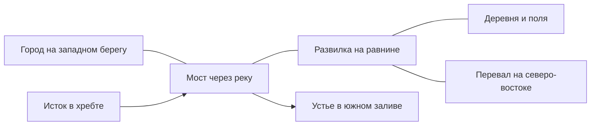

# Основа нового рендера глобальной карты

Проектное решение этапа A для утверждения в [#184](https://github.com/akglebak16/iron-standard/issues/184). Самостоятельная сцена `res://apps/godot/presentation/overworld/render_probe.tscn` проверяет регистрацию нативного класса, камеру и вывод геометрии через Godot на Windows. Испытательная геометрия берега служит проверкой сборки.

## Контракт данных

| Поток | Данные и правила |
|---|---|
| Авторская разметка или генератор → модель мира на C++ | Общие координаты XY в мировых единицах, высота отдельным полем. Поля высоты, весов биомов и леса. Векторные объекты со стабильными ID для водоёмов, русел с шириной, гребней, проходов, дорог, переправ и поселений. Наземная проходимость и дорожный граф принадлежат модели мира. |
| Модель → представление | Начальный неизменяемый снимок с ID мира и ревизией. В дальнейшем изменения применяются пакетом на границе шага симуляции. Пакет содержит предыдущую и новую ревизии, старые и новые границы изменённых объектов и удалённые ID. Пропуск ревизии требует нового снимка. |
| Динамические данные → представление | Положение и направление отряда на двух соседних шагах, состояние и владелец поселения, время мира, параметры погоды. Камера интерполирует видимое движение по опубликованным данным. Выбор возвращает стабильный ID. Команды строительства и перемещения проверяет модель мира. |
| Godot Resources → нативный компоновщик | При загрузке преобразуются в таблицы материалов, пропорций, якорей и вариантов. Положение элементов воспроизводится по seed, стабильному ID и правилу композиции. Текстуры, шейдеры и их загрузка остаются в адаптере Godot. |

Код географии и будущих правил кампании размещается у владельца `core/campaign`. Композиция, пространственный индекс рендера и подготовка пакетов принадлежат представлению. Рабочие задачи C++ принимают обычные структуры данных. Доступ к SceneTree, создание текстур и публикация GPU-буферов происходят в главном потоке. Этап A использует существующий Windows GDExtension и автоматическую проверку загрузки сцены. Изменения публичных границ модулей оформляются ADR и исполняемым тестом при добавлении соответствующего контракта.

## Порядок сборки кадра

1. Поверхность и вода используют общую сетку проб в мировых координатах. Маски и полосовая геометрия в соседних чанках читают одинаковые значения на границе. Ширина, материал и координата вдоль дороги или реки непрерывны через шов.
2. Хребет собирается вдоль гребня из пиков и подножий. Коридоры проходов и дорог резервируются до расстановки. Лес компонуется плотными группами с переходом к опушке. Крупные силуэты и их точки опоры определяют порядок перекрытия относительно дорог, построек и отрядов.
3. Дорога стыкуется с воротами и мостом по явным якорям. При редактировании пересчитываются чанки, затронутые прежним или новым следом, с учётом соседней полосы и размеров рисунка. Протяжённый объект учитывается единожды по ID. Смена владельца поселения обновляет соответствующие элементы и подпись.
4. Очередь отдаёт приоритет видимым чанкам и предзагрузке по направлению камеры. Результат применим при совпадении ID мира, версии чанка, версии стиля и нужного LOD. Буфер старого LOD остаётся видимым до готовности нового. Для повторяемых элементов с совместимым перекрытием применяются группы MultiMesh по чанкам.
5. Освещение получает цвет и направление солнца, рассеянное освещение и свечение окон отдельно от геометрии. Время обновляет общие параметры материалов. У земли и архитектуры раздельно хранятся цвет, отклик направленного света и контактная тень.

## Испытательный мир

При среднем зуме целевой кадр 1672 × 941 показывает залив на юге, равнину между руслом реки и берегом, хребет на северо-востоке. Деревня находится за рекой. Тракт от городских ворот проходит через мост и ветвится к деревне и перевалу. Лес закрывает боковые склоны и оставляет читаемой линию проезда. В испытании второй seed меняет линию берега, русло и седловину. Одинаковый набор материалов и частей должен выдержать обе раскладки.



## Разбор скрина № 2

Источник для художественной приёмки — второй скрин пользователя размером 1672 × 941. Содержимое игрового интерфейса исключено из разбора. Приведённые размеры сняты ориентировочно для среднего масштаба и служат стартовыми пропорциями. В тестовой сцене за одну мировую единицу принимаем один экранный пиксель при зуме 1×. Текстуры деталей готовим с вдвое большей плотностью для зума 2×.

| Фрагмент оригинала | Что воспроизводим | Требования к ресурсу |
|---|---|---|
| Бельмон, ворота и тракт | Город около 280 × 210 px доминирует над местностью. Золотистый тракт около 9–12 px читается на всём протяжении. | Городские группы с точкой опоры и отдельным якорем ворот. У дороги независимые сердцевина, тёмный контур и край грунта. |
| Деревня, фигурка и лес | Деревня с двором занимает около 100–160 px в ширину. Отряд читается за счёт силуэта и знамени высотой около 50–60 px. | Дома, поля и кроны объединяются в группы. У фигурки якорь на земле. Кроны разного размера с плотным ядром леса и разреженным краем. |
| Горный массив и залив | Горы читаются крупными светлыми и холодными теневыми плоскостями. У тёмной сине-зелёной воды узкая светлая кромка. Волны вторичны по контрасту. | Раздельные пики, склоны и предгорья с совпадающей стилизацией. Кромка берега строится вдоль общей линии воды и суши. |

Палитра опирается на оливково-охристую равнину, тёмные зелёные кроны, тёплый камень стен, терракотовые крыши, холодные тени гор и глубокую сине-зелёную воду. Земля хранит крупный цветовой рисунок и отдельную мелкую фактуру. У каждого вырезного элемента мягкая контактная тень вынесена отдельно. Мип-уровни атласа должны сохранять тёмный контур и цвет края при отдалении. На зуме 0,5× проверяем силуэты и тракт, на 1× композицию референса, на 2× помещённые в атлас детали и стыки.

## Приёмка следующего этапа

- Стенд этапа A — Windows 11 Home, Intel Core i5-14400F с 16 логическими процессорами, 31,7 ГиБ доступной физической памяти и NVIDIA GeForce RTX 4070 SUPER, драйвер 32.0.16.1060. Godot 4.7.2, GL Compatibility.
- Оконный запуск release при 1920 × 1080 на одной зафиксированной машине. Рабочий ориентир 60 FPS. Сравнивать p95 и p99 времени кадра, максимум, первый показ, CPU/GPU-память и очередь готовых пакетов.
- Маршрут включает старт с холодным кэшем, перемещение вдоль шва, пересечение шва, зум, возвращение в выгруженный район и изменение переправы во время движения.
- Проверить приём снимков по ревизиям, воспроизводимость размещения после выгрузки, геометрию на стыке чанков и маршрут до и после постройки моста. Профиль нагрузки и размер чанка измеряются на работающем ядре.

## Техническая сцена этапа B

Откройте `res://apps/godot/presentation/overworld/overworld_trial.tscn` в Godot и запустите её через F6. Для запуска той же сцены в релизной сборке передайте `-- --overworld-trial`. Стрелки и перетаскивание средней кнопкой перемещают камеру, колесо меняет масштаб. Переключатель «Переправа» меняет проходимость и геометрию настила. «Перезагрузить область» сохраняет состояние переправы и возвращает отряд к началу маршрута.

Сцена строит испытательную карту из 40 участков по 320 мировых единиц. Один выделенный поток C++ готовит геометрию из копии состояния. Кадр применяет максимум один результат и рисует отряд между соседними шагами испытательной симуляции. Удерживаются видимые чанки и запас в один чанк вокруг. Версия мира защищает от публикации после перезагрузки. Открытие и закрытие моста обновляет ревизии двух пересекаемых чанков. Небольшой фиксированный маршрут и плоские цвета служат испытательными данными.

Замер с выключенной вертикальной синхронизацией выполняет движение камеры, зум, установку переправы и перезагрузку области. Из корня репозитория запустите оконную сборку с такими аргументами и укажите существующий каталог для отчёта.

```powershell
& .\dist\godot\migration-release\IronStandard.exe --resolution 1920x1080 -- --overworld-benchmark C:/path/to/overworld-trial
```

На диске появятся JSON с p50/p95/p99, максимальным временем кадра и счётчиками чанков, а также PNG последнего кадра. Этот сценарий измеряет техническую карту с простыми материалами. Профиль под художественной нагрузкой проверяется на вертикальном срезе.

## Художественный регион этапа C

Запуск релизной сборки с `-- --overworld-region` открывает прибрежную равнину. В редакторе откройте сцену `res://apps/godot/presentation/overworld/art_region.tscn` и нажмите F6. По умолчанию переправа открыта. Кнопка времени суток переводит часы мира на ночь, рассвет и полдень. Один игровой час занимает 45 секунд. Материалы читают высоту солнца для оттенка поверхности, направления падающей тени и свечения окон.

Нативная модель задаёт общую ось тракта для геометрии дороги и движения отряда. Рисунок луга и волн привязан к мировым координатам. Чанк владеет иллюстрациями по их наземным якорям, а порядок перекрытия определяется высотой якоря на экране. Три атласа содержат группы вершин, кроны, опушки, поля и поселения. Переправа использует отдельную иллюстрацию, а отряд получает фигуру из действующей библиотеки кампании. Хребет и рощи собираются при подготовке чанка из повторно используемых частей.

Для оконного замера передайте `-- --region-benchmark C:/path/to/region`. Маршрут камеры и события переправы совпадают с техническим бенчмарком. После измерений программа сохраняет кадры одного ракурса с суффиксами `-06.png`, `-12.png` и `-22.png`. Экранный интерфейс скрывается только для съёмки этих кадров.

Разбор композиции референса, пробы цвета и правила построения местности приведены в [художественном разборе](overworld-reference-study.md).

Для повторения конкретного варианта передайте `-- --overworld-region --region-seed=47`. По умолчанию используется 188. Для проверки пяти вариантов используйте seed 188, 19, 47, 103 и 271. Положение поселений и переправы постоянно, профиль склонов, перевал, лес и трассировка подъездов воспроизводятся по seed.
