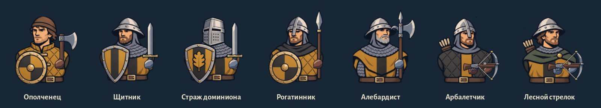
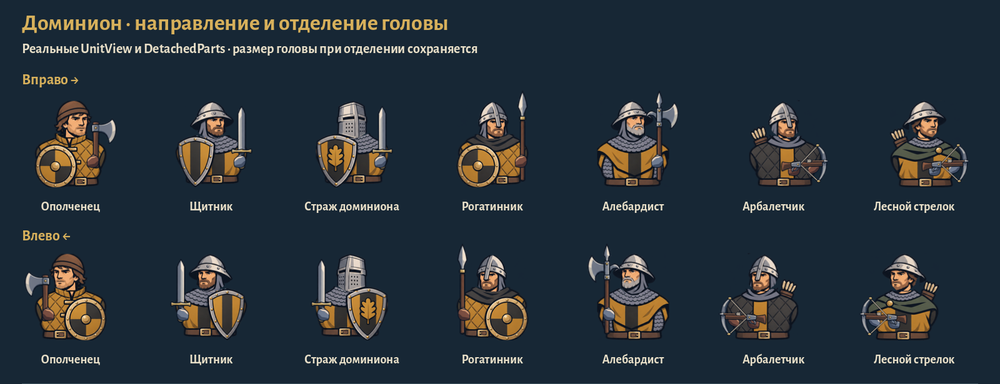

# Визуальный стиль юнитов «Железного Стяга»

Выбранное направление — **сдержанная геральдическая графика**. Боец выглядит как рисованная средневековая фигурка, узнаваемая по контуру, вооружению и цветовым пятнам. Эталон внедрения — семь пеших типов Мядельского доминиона. Этот гайд фиксирует их внешний вид и задаёт правила для будущих наборов. Для конницы, героев и остальных фракций эти правила пока служат направлением развития.

## История и эталоны

| Версия | Что смотреть |
| --- | --- |
| [Выбранный концепт](unit-references/01-heraldry-concept.png) | Воин, лучник и всадник. Общий характер линии, лиц и материалов. Состав концепта сам по себе не задаёт оружие или состав игровых войск. |
| [Первая игровая версия целиком](unit-references/02-full-units-initial.png) | Все семь бойцов до правок пропорций. История внедрения и отправная точка для сравнения. |
| [Цельный образ перед точным разделением](unit-references/03-full-units-before-split.png) | Последний цельный вид бюстов, с округлёнными плечами, укрупнёнными щитами и варежками. [Исходный лист бюстов с цельной головой и торсом](../../tools/battle/heraldic_source/body.png). |
| [Актуальная сборка в обе стороны](unit-references/04-units-after-split.png) | Все семь бойцов после выделения головы, новый стык шеи и воротника. Это основной эталон посадки. |
| [Проверка слоёв всех семи типов](unit-references/06-assembled-and-parts.png) | Собранные фигуры, торсы и отдельные головы; технический лист масок. |
| [Кадр отделения](unit-references/05-separation-frame.png) | Кадр из игрового рендера с той же головой, шлемом и масштабом до и после отделения. |
| [Бой](unit-references/07-battle-scale.png) и [журнал отряда](unit-references/08-party-portraits.png) | Проверка живых моделей в строю и портретов в реальном интерфейсе. |

## Форма, свет и детализация

- Сохраняем формат бюста от пояса до шлема и общую трёхчетвертную подачу. Высоту глаз, шеи и пояса сверяем в одном ряду. Разницу классов передают форма шлема, плечи, оружие, щит и ткань. Более тяжёлый боец кажется тяжелее за счёт экипировки и силуэта.
- Лицо рисуем собранным и спокойным. Глаза, нос и подбородок обозначаем крупными формами. Избегаем преувеличенной мимики, слишком больших глаз, пластиковой кожи и одинаковых лиц у всех. Для вариативности меняем оттенок кожи, растительность на лице и отдельные детали с сохранением роли.
- Внешний контур глубокий угольный или сине-чёрный. Внутренние линии тоньше, особенно вокруг лица. Контур должен оставлять достаточно площади под глаза, хват и проём шлема на игровом масштабе.
- Базовый свет мягкий, сверху под углом. Для большинства деталей хватает базы, тени и одного светлого тона. Сталь читается сдержанной светлой гранью, подшлемник и кольчуга — холодной серой массой с крупным ритмом, кожа — тёплым матовым пятном, дерево — цветом и формой, шерсть и лён — широкими складками. Блёстки, произвольные градиенты, микрозаклёпки и зерно оставляем за пределами игрового спрайта.
- Приоритет в уменьшении — силуэт, тип оружия, знак фракции, границы лица и только затем фактура. Сверяем при 32, 48 и 64 px и на фактических зумах боя; на малом размере рисунок не должен превращаться в сетку линий.

## Палитра и геральдика

Рабочие опорные цвета исходника Доминиона — приглушённая охра `#AD883A` и угольный `#343329`. Это ориентиры для ткани и крупных полей, а готовый атлас содержит их тени и свет. Нейтральная сталь, тёплая кожа и дерево связывают состав. У лесного стрелка тёмная зелень плаща даёт дополнительный признак роли. На щите стража крупный золотой дубовый мотив; мелкие заклёпки второстепенны.

У каждой следующей фракции задаём основное пятно ткани, контрастное поле, материалы и узнаваемый знак. Чтобы различать стороны и роды на траве, снегу и у стен, сочетание цвета дублируем формой знака и силуэтом. Отдельно сверяем смену знамени: перекрашиваем выбранные поля ткани и щита, сохраняя металл, кожу, лица и хват. Симметричные знаки выдерживают зеркальное отражение. Для надписей и асимметричных эмблем нужен отдельный тест на обе стороны.

## Пешая линейка Доминиона

| Тип | Отличимый силуэт и хват |
| --- | --- |
| Ополченец · `d1` | Мягкая шапка, стёганка, круглый щит, короткий топор и кожаная варежка. |
| Щитник · `d2` | Шлем с полями и кольчугой, вытянутый щит, короткий прямой меч, стальная варежка. |
| Страж · `d3` | Закрытый шлем, тяжёлый щит с дубовым мотивом, прямой меч, стальная варежка. |
| Рогатинник · `d2s` | Нашлемный наносник, тёмный ворот, круглый щит, длинное древко с узким наконечником, кожаная варежка. |
| Алебардист · `d3s` | Шлем с полями, широкая кольчужная горловина, узнаваемый профиль алебарды, одна стальная варежка на древке. |
| Арбалетчик · `d2x` | Наносник, тёмная стёганка и широкая охристая полоса, колчан с болтами, кожаные варежки. |
| Лесной стрелок · `d3x` | Шлем с полями, тёмно-зелёная накидка и кольчуга, колчан с болтами, стальные варежки. Оружие — арбалет. |

## Кисти, крепления и движение

- Кисти рисуем как цельные варежки без предплечий, манжет и отдельных пальцев. Кисть шире рукояти и читается как рука. С видимой стороны — тыльная поверхность, ладонь закрывает рукоять, большой палец заворачивается внутрь хвата. Материал варежки совпадает с типом снаряжения.
- У оружия ближнего боя кисть держится за ось рукояти на покое и в замахе. Щит закрывает торс и читается крупным пятном. У алебарды одна кисть. У арбалета одна кисть у спуска, другая под ложем. Тетива, болт и направление выстрела читаются поверх хвата.
- Исходник хранит цельный бюст и раздельные рабочие слои. Для каждой головы нужны контур отделения, стык шеи, центр вращения и проверка полного силуэта. В этой линейке центр шеи в кадре 152×176 находится в точке (76, 78). Координаты других наборов определяются их рисунком и масштабом.
- Канонический кадр Доминиона смотрит вправо; при отражении лицо, хват и направление оружия меняются вместе. Щит и портрет сверяем отдельно. Воротник скрывает стык в покое и движении. После отделения сохраняются шлем, размер головы, вариант лица и отражение.
- Дыхание и шаг оставляют пятно корпуса устойчивым. Ближняя атака читается по подготовке, удару и возврату; стрелковая — по удержанию направления, короткой отдаче и возврату оружия в стойку. Падение тела и отделение части синхронизируем с существующим событием. Визуальные фазы используют уже имеющиеся данные боя.

## Связь с миром и интерфейсом

Фигуры заметнее земли, но подчиняются тем же материалам и свету, что деревья, здания и стена. У травы, снега, воды и полей ниже контраст мелких деталей. Поселения, дороги, границы и знаки отрядов остаются различимыми на карте кампании. В бою приоритет у бойцов, меток команд и снарядов.

В журнале, городе и составе отряда используем тот же собранный портрет. Состояния кнопок и метки строим на общей теме игры: тёмные тёплые поверхности, латунные акценты, существующие шрифты и пиктограммы. Герб, оружие и свет на лице помогают связать карточку с фигурой в бою. Эти принципы подходят для новых окон и постепенной доработки карты.

## Передача ассетов и приёмка

1. К каждому набору сохраняем цельный рисунок, отдельные слои, схему имён и креплений, источник и лицензию. В журнале ассетов фиксируем способ воспроизведения. Отдельно подписываем концепты и скрины игры.
2. Сверяем весь набор в одном масштабе, вправо и влево. Снимаем покой, движение, блок, атаку, выстрел, падение и отделение, проверяем обе настройки крови. Для эффектов сравниваем первый кадр, полёт и покой на земле. На трупе и в частях проверяем силуэты, отсутствие дублирующей экипировки и положение тени.
3. Смотрим одиночного бойца, плотный строй, траву, снег, осаду, портрет и смену знамени. Для нового типа проверяем соседство с предыдущими классами, а не только большой портрет.
4. Используем готовые атласы и пакетную отрисовку. Сверяем совпадение GDScript и native. Для правок боевой отрисовки сравниваем кадр, draw calls, память и тяжёлые сцены одинаковой численности до и после. Тесты запуска и сравнение кадров оцениваются отдельно от замеров FPS.

Исходники лежат в [heraldic_source](../../tools/battle/heraldic_source/), упаковщик — [render_heraldic_faction.cjs](../../tools/battle/render_heraldic_faction.cjs) (`dominion`), сцены просмотра — [фигуры и оружие](../../tools/battle/dominion_preview.gd) и [головы и направление](../../tools/battle/dominion_head_preview.gd). [Журнал ассетов](../ASSETS.md).

## Открытый визуальный долг

- Полировка моделей, лиц, кистей и стыка головы у всех семи типов. [#155](https://github.com/akglebak16/iron-standard/issues/155)
- Полировка отделения головы, посадки эффекта и падения тела. [#156](https://github.com/akglebak16/iron-standard/issues/156)
- Приведение отделяемых кистей, рук, фрагментов и экипировки к конкретным скинам. [#157](https://github.com/akglebak16/iron-standard/issues/157)
